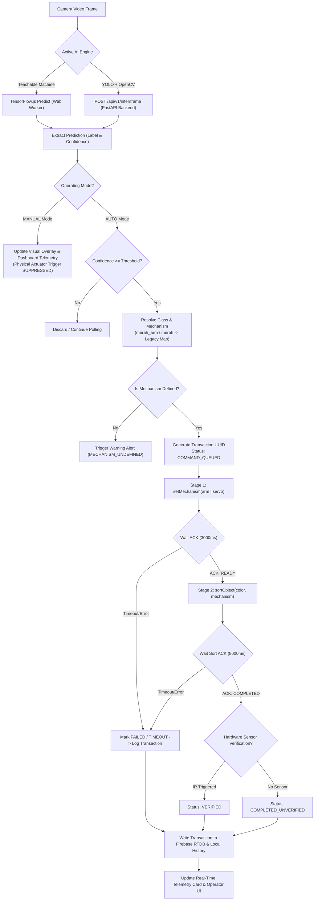

# VERNOVA — Developer Architecture & Integration Guide

Buku panduan ini ditujukan bagi pengembang perangkat lunak, *maintainer*, dan teknisi sistem yang ingin memelihara, memperluas, atau mengintegrasikan kode sumber platform **VERNOVA Smart Sorting Factory**.

---

## 1. Arsitektur Perangkat Lunak

Platform VERNOVA dirancang menggunakan pola modular tanpa framework frontend monolitik yang berat, memungkinkan eksekusi berkecepatan tinggi langsung di browser serta kompatibilitas maksimal dengan runtime web modern dan edge devices.

```
VERNOVA System Architecture
│
├── Frontend (Browser Client)
│   ├── index.html                  (Main Dashboard & Operator Station)
│   ├── assets/js/device-manager.js (State Machine, Hardware Adapters, 2-Stage Queue)
│   ├── assets/js/yolo-client.js    (FastAPI YOLO Client & Detection Extractor)
│   ├── assets/js/yolo-studio-ui.js (Training Studio, Annotator, Project Manager)
│   ├── assets/js/smart-assistant.js(Deterministic Rule-Based Query Engine)
│   └── assets/css/                 (Custom Dark UI & Responsive Theme)
│
├── AI Vision Engines
│   ├── Google Teachable Machine    (TensorFlow.js classification in browser)
│   └── YOLO Training Studio        (Ultralytics YOLOv8 + OpenCV in Python FastAPI)
│
├── Hardware Microcontrollers
│   ├── ESP32 DevKit V1 (Wi-Fi REST & BLE GATT Nordic UART)
│   └── BBC micro:bit   (MakeCode Bluetooth UART Service)
│
└── Data & Persistence
    ├── Firebase Realtime Database (Real-time Cloud Logging & Telemetry)
    └── Local Storage / Memory     (Offline fallback & UI preferences)
```

---

## 2. Diagram Alir Komprehensif (End-to-End Pipeline)

Diagram berikut mengilustrasikan alur lengkap dari pengambilan frame kamera hingga verifikasi sensor fisik aktuator:



---

## 3. Rincian Modul Inti

### 3.1 `assets/js/device-manager.js`
Modul ini adalah pengendali komunikasi terpadu (*Communication Hub*).

- **`OPERATING_MODES`:** Enum `{ AUTO: 'AUTO', MANUAL: 'MANUAL' }`.
- **`TRANSACTION_STATES`:** Siklus hidup transaksi dari `IDLE`, `COMMAND_QUEUED`, `AWAITING_MECHANISM_ACK`, `AWAITING_CLASS_ACK`, `SORTING`, `VERIFYING`, hingga status akhir.
- **`STATUS_CATEGORIES`:** Kategori standar industri untuk pencatatan riwayat (`detected`, `command_sent`, `command_acknowledged`, `sorting`, `completed_unverified`, `verified`, `failed`, `timeout`, `unknown`).
- **`resolveClassAndMechanism(rawClass, legacyMap, fallbackMechanism)`:**
  - Mendeteksi format nama kelas 6-mekanis (`merah_arm`, `biru_servo`).
  - Memetakan model 3-kelas warna lawas melalui konfigurasi operator (`legacyMap`).
  - Menolak ambigu bila mekanisme tidak terdefinisi.
- **`DeviceConnectionManager.executeTwoStageSort(targetColor, targetMechanism, options)`:**
  - Menjalankan orkestrasi 2 tahap.
  - Memeriksa batas waktu (*timeouts*) secara independen untuk tiap tahap.
  - Menerbitkan event status melalui `_notifyStatusChange()`.

### 3.2 `assets/js/yolo-client.js`
Klien komunikasi dengan backend YOLO FastAPI.
- Menangani inferensi frame langsung via HTTP multipart form-data atau Base64.
- Fungsi `extractTopColorDetection(detections, threshold)`:
  - Memfilter kelas deteksi yang valid.
  - Menerapkan aturan seleksi: **Confidence tertinggi**, jika sama maka pilih objek dengan **Luas Bounding Box (Bounding Box Area) terbesar**.

### 3.3 Backend YOLO Training Studio (`yolo_studio/`)
- `server.py`: FastAPI server yang mengelola endpoint manajemen dataset, anotasi gambar, background training jobs, dan real-time inference.
- `inference_engine.py`: Memuat model PyTorch YOLOv8 (`.pt`) dan menjalankan Non-Maximum Suppression (NMS) dengan IoU > 0.5 untuk mencegah deteksi ganda pada objek yang berdekatan di atas conveyor belt.

---

## 4. Skema Database Firebase Realtime Database

Struktur JSON node `/sortHistory` yang diperbarui pada Phase 2:

```json
{
  "sortHistory": {
    "-OAbc1234XYZ": {
      "transactionId": "txn_1732520000000_abc1",
      "timestamp": 1732520000000,
      "dateString": "25/11/2026, 17:00:00",
      "color": "kuning",
      "mechanism": "arm",
      "predictedClass": "kuning_arm",
      "confidence": 0.94,
      "aiEngine": "yolo",
      "sortingMode": "AUTO",
      "targetDevice": "ESP32",
      "connectionType": "WIFI",
      "statusCategory": "completed_unverified",
      "verificationStatus": "completed_unverified",
      "verified": false,
      "executionDurationMs": 1420,
      "status": "COMPLETED"
    }
  }
}
```

---

## 5. Panduan Menjalankan Pengujian Otomatis (Unit & Integration Tests)

VERNOVA dilengkapi rangkaian pengujian otomatis untuk memverifikasi fungsionalitas modul tanpa memerlukan perangkat fisik.

### 5.1 Menjalankan Pengujian Node.js

Pengujian mencakup adapter perangkat, state machine, mutual exclusion auto/manual, dan 2-stage cycle:

```bash
# Jalankan seluruh suite test Node.js
node --test tests/*.test.js
```

Rincian file pengujian:
- `tests/phase2_sorting_protocol.test.js`: Pengujian 6-kelas mekanis, resolusi kelas lawas, auto/manual exclusion, 2-stage execution cycle, dan sensor verification classification.
- `tests/device_manager_adapters.test.js`: Pengujian koneksi ESP32 Wi-Fi, ESP32 BLE, dan micro:bit BLE.
- `tests/smart_assistant.test.js`: Pengujian deterministic NLP data assistant.

### 5.2 Menjalankan Pengujian Python Backend

Pengujian API YOLO Studio dan Inference Engine:

```bash
# Jalankan test suite Python
python -m unittest tests/test_yolo_studio.py
```

---

## 6. Prosedur Menambah Adapter Mikrokontroler Baru

Untuk menambahkan mikrokontroler atau protokol baru (misalnya Raspberry Pi Pico W atau MQTT):

1. Buat class turunan dari `BaseDeviceAdapter` di `assets/js/device-manager.js`:
```javascript
class RaspberryPiMqttAdapter extends BaseDeviceAdapter {
  constructor(config = {}) {
    super('RPI_PICO', 'MQTT', config);
  }

  async connect(options = {}) {
    // Implementasi koneksi MQTT Client
  }

  async setMechanism(mechanism, options = {}) {
    // Stage 1: Publikasi topik vernova/cmd/mechanism
  }

  async sortObject(color, mechanism, options = {}) {
    // Stage 2: Publikasi topik vernova/cmd/sort
  }
}
```
2. Daftarkan adapter baru ke dalam `DeviceConnectionManager.adapters` map.
3. Tambahkan unit test pada folder `tests/` untuk memverifikasi kepatuhan terhadap 2-stage execution cycle.
